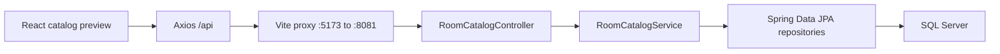

<!-- Author: Phan Tuan Thanh - CE190595 -->

# Design

## Implemented foundation

The Maven backend remains at the repository root. The React project is `frontend/A3PhanTuanThanh_SE1910`. Constructor injection and read-only service transactions keep DTO mapping inside the persistence context. Controllers return DTO records, not entities; no customer data/password is exposed. Database access errors return HTTP 503 with a generic English message.

| Entity/table | Key and relationships |
| --- | --- |
| `RoomType` | Identity `RoomTypeID`; referenced by rooms |
| `RoomInformation` | Identity `RoomID`; required `RoomTypeID` FK |
| `Customer` | Identity `CustomerID`; unique email; password length 255 |
| `BookingReservation` | Sequence-generated `BookingReservationID`; required `CustomerID` FK |
| `BookingDetail` | Embedded `(BookingReservationID, RoomID)` PK, `@MapsId` to reservation/room; start/end dates and actual price |

SQL `money` maps to `BigDecimal`, `date` to `LocalDate`, nullable `tinyint` to `Short` with an explicit JDBC tinyint mapping, and Unicode fields to nationalized strings. Relationships are unidirectional many-to-one with lazy loading and no remove cascade. All four database FKs use `NO ACTION` after migration.

`database/02-original-schema.sql` retains the provided schema (including customer identity seed 3) under the A3 database name. `03-a3-migration.sql` widens passwords, creates a sequence if needed, and replaces cascades. `04-seed.sql` inserts two types/three rooms without credentials and can be rerun. JPA bootstrap on a new database uses provider-default identity seed 1; application behavior never assumes a particular customer ID. Only one of the two schema creation paths should run per database.

Normal startup uses `ddl-auto=validate`; the explicit `bootstrap` profile uses `update` to satisfy JPA schema creation on an empty database. Scripts are executed manually. No automatic schema reset occurs. A migration on existing bookings without a sequence stops for review rather than guessing an ID.

## API scope

Implemented: public `GET /api/rooms` and `GET /api/room-types`. No writes or authentication endpoints exist yet. Bootstrap endpoints support actual room/room-type queries and a minimal frontend preview.

Planned APIs: customer registration/login, own profile/history/bookings, staff customer/room CRUD/search, staff reservations/details. Route contracts will be finalized in the relevant stage and recorded here.

## Planned security and booking behavior

A3-02 will add Spring Security, BCrypt and JWT with `STAFF`/`CUSTOMER` roles. Staff credentials come through application configuration/environment, not a staff table. JWT requests will flow through a filter and role rules before controllers. Customer APIs must derive ownership from authenticated identity.

A3-03 will soft-disable referenced rooms and reject deletion of customers with reservations. A3-04 will create all booking details in one transaction, validate rooms/dates/status/overlap and calculate totals using `BigDecimal`. These service rules and overlap handling are not implemented in A3-01. Database constraints already prevent cascading history loss.

Version reference: [Spring Boot 3.5 requirements](https://docs.spring.io/spring-boot/3.5/system-requirements.html). Schema modes follow [Spring Boot database initialization](https://docs.spring.io/spring-boot/3.5/how-to/data-initialization.html).
