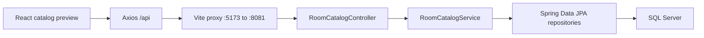

<!-- Author: Phan Tuan Thanh - CE190595 -->

# Design

## Implemented foundation

The Maven backend remains at the repository root. The React project is `frontend/A3PhanTuanThanh_SE1910`. Constructor injection and read-only service transactions keep DTO mapping inside the persistence context. Controllers return DTO records, not entities; no customer data/password is exposed. Database access errors return HTTP 503 with a generic English message.

| Entity/table | Key and relationships |
| --- | --- |
| `RoomType` | Identity `RoomTypeID`; referenced by rooms |
| `RoomInformation` | Identity `RoomID`; required `RoomTypeID` FK |
| `Customer` | Identity `CustomerID`; unique email; password length 255 |
| `BookingReservation` | Sequence-generated `BookingReservationID`; required `CustomerID` FK |
| `BookingDetail` | Embedded `(BookingReservationID, RoomID)` PK, `@MapsId` to reservation/room; start/end dates and actual price |

SQL `money` maps to `BigDecimal`, `date` to `LocalDate`, nullable `tinyint` to `Short` with an explicit JDBC tinyint mapping, and Unicode fields to nationalized strings. Relationships are unidirectional many-to-one with lazy loading and no remove cascade. All four database FKs use `NO ACTION` after migration.

`database/02-original-schema.sql` retains the provided schema (including customer identity seed 3) under the A3 database name. `03-a3-migration.sql` widens passwords, creates a sequence if needed, and replaces cascades. `04-seed.sql` inserts two types/three rooms without credentials and can be rerun. JPA bootstrap on a new database uses provider-default identity seed 1; application behavior never assumes a particular customer ID. Only one of the two schema creation paths should run per database.

Normal startup uses `ddl-auto=validate`; the explicit `bootstrap` profile uses `update` to satisfy JPA schema creation on an empty database. Scripts are executed manually. No automatic schema reset occurs. A migration on existing bookings without a sequence stops for review rather than guessing an ID.

## API scope

Implemented: public `GET /api/rooms` and `GET /api/room-types`. No writes or authentication endpoints exist yet. Bootstrap endpoints support actual room/room-type queries and a minimal frontend preview.

Planned APIs: customer registration/login, own profile/history/bookings, staff customer/room CRUD/search, staff reservations/details. Route contracts will be finalized in the relevant stage and recorded here.

## Authentication and role security (implemented A3-02)

`config/SecurityConfig.java` uses Spring Security's BearerTokenAuthenticationFilter with Nimbus HS256 validation, issuer `fuminihotel`, expiration checking and stateless sessions. JWT subject is the customer ID or `staff`; the `role` claim maps to `ROLE_CUSTOMER`/`ROLE_STAFF`. Tokens expire after one hour. Keys and configured staff credentials come from environment/ignored local properties. Staff password is BCrypt-encoded in memory; customer passwords are BCrypt hashes in SQL Server.

Public: POST `/api/auth/register`, POST `/api/auth/login`, GET `/api/rooms`, GET `/api/room-types`. Customer only: GET/PUT `/api/profile`. Staff path `/api/staff/**` is reserved for STAFF. Other routes are denied. Staff customer/room APIs were added in A3-03 (see below).

Registration body: `{profile: {customerFullName, telephone, emailAddress, customerBirthday}, password}`. Login body: `{email, password}`. DTO validation enforces lengths, email, past birthday and telephone shape. Passwords require 8-64 characters and at most 72 UTF-8 bytes. Duplicate/reserved emails return 409. Validation returns 400 plus fieldErrors; absent/invalid token returns 401, wrong role 403. Profile DTOs exclude passwords.

Booking transactions/overlap checks remain planned for A3-04. The existing FKs already prevent cascade loss.

## Staff management (implemented A3-03)

`StaffManagementController` -> `StaffManagementService` -> repositories. STAFF can GET/list/search, POST, PUT and DELETE `/api/staff/customers` and `/api/staff/rooms` (item operations use `/{id}`). Lists accept `?search=` (maximum 100 characters). Customer search matches name/email; room search matches number/description. GET `/api/room-types` supplies options.

Staff customer bodies contain validated `profile`, `customerStatus` (1 active/2 inactive), and a password required on create, optional on update. DTOs never include password hashes. Referenced customers cannot be deleted (409); staff can deactivate them. Room bodies validate number/description/capacity/type/status/positive money up to 1,000,000,000 with at most four decimal places. Room numbers are checked for duplicates in the service. Room writes/deletion acquire a pessimistic row lock. A referenced room is deactivated (status 2) by DELETE; an unused room is physically deleted. Foreign keys remain a second history safeguard.
