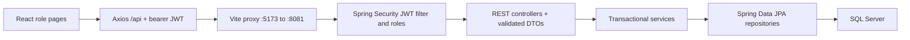

<!-- Author: Phan Tuan Thanh - CE190595 -->

# Design

## Persistence and schema

| Entity | Key and relationships |
| --- | --- |
| RoomType | Identity RoomTypeID; referenced by rooms |
| RoomInformation | Identity RoomID; required RoomTypeID; unique RoomNumber |
| Customer | Identity CustomerID; unique email; password nvarchar(255) |
| BookingReservation | dbo.BookingReservationSequence; required CustomerID |
| BookingDetail | Embedded (BookingReservationID, RoomID) PK; @MapsId reservation/room links |

Money maps to BigDecimal, date to LocalDate, tinyint status to Short with JDBC tinyint mapping, and Unicode text to nationalized strings. Lazy unidirectional many-to-one relationships have no remove cascades. The service creates DTOs inside transactions, avoiding entity serialization/lazy errors. Four SQL foreign keys use NO ACTION.

Script 01 creates the database; script 02 preserves the original schema under its A3 name; script 03 widens passwords, provides the sequence, replaces cascades and adds unique room numbers; script 04 seeds two types/three rooms. Choose JPA bootstrap or original-derived SQL schema creation, then apply migration/seed. Normal ddl-auto is validate. Original SQL customer identity starts at 3; JPA defaults to 1; no behavior assumes a customer identity value.

## Authentication and API contracts

SecurityConfig uses Spring Security's BearerTokenAuthenticationFilter and Nimbus HS256 encoder/decoder, issuer fuminihotel, expiry validation and stateless sessions. AuthService checks BCrypt customer hashes or the configured staff password hash and issues a one-hour JWT. Subject is customer ID or staff; role maps to ROLE_CUSTOMER/ROLE_STAFF. Staff credentials/signing key come from configuration, never a Staff table. Customer services recheck active account status.

Public GET /api/rooms, /api/room-types and POST /api/auth/register, /api/auth/login. Customer-only GET/PUT /api/profile, GET/POST /api/bookings, GET /api/bookings/{id}. Staff CRUD/search routes are /api/staff/customers, /api/staff/rooms, /api/staff/bookings, with item /{id} and booking PATCH /{id}/status. See [README](../README.md) for methods/bodies.

Profile validation requires name (50 max), telephone (7-12 allowed characters), email (50 max), past birthday; passwords require 8-64 characters and at most 72 UTF-8 bytes. Staff customer update may omit password. DTOs exclude hashes. Field errors return 400, missing/invalid session 401, wrong role 403, missing item 404, conflicts 409 and database unavailability 503, using English messages.

## Transactions and history

BookingService validates distinct room IDs and stay dates before writing. It locks the edited reservation and affected room rows in ascending room ID order, checks active rooms and active-reservation overlaps, snapshots current nightly prices into ActualPrice, and calculates TotalPrice with BigDecimal. Failed creates/edits roll back. Staff PUT intentionally manages the detail set and recalculates totals. Cancellation retains all details/prices; reactivation checks availability. Concurrent same-room requests were tested: one succeeds and one receives 409.

StaffManagementService locks room writes/deletion. Existing detail references cause room status 2; unused rooms are deleted. Customers with history cannot be deleted. SQL FKs back these checks. Booking history ownership uses JWT subject, not a request customer ID.

## React

App.jsx/Protected guard staff and customer routes. AuthContext/session.js keep token, role, display name and expiry in sessionStorage; refresh preserves the tab session, logout/expiry/401 clears it. Passwords are not stored. Profile changes update the display name without extending token expiry.

Pages call actual APIs through api.js. ProfileFields, BookingEditor, BookingDetails and Notice share small UI responsibilities. BookingEditor supports multiple room/date rows, duplicate/date checks and an estimate; the server returns the authoritative total. Explicit select labels and native date input synchronization support browser use. localDate uses the local calendar (tested for Bangkok midnight/year/leap-day boundaries). Staff list request counters prevent an older response from replacing a newer search.
